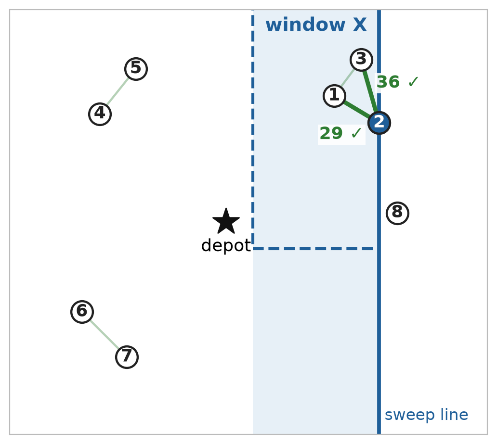
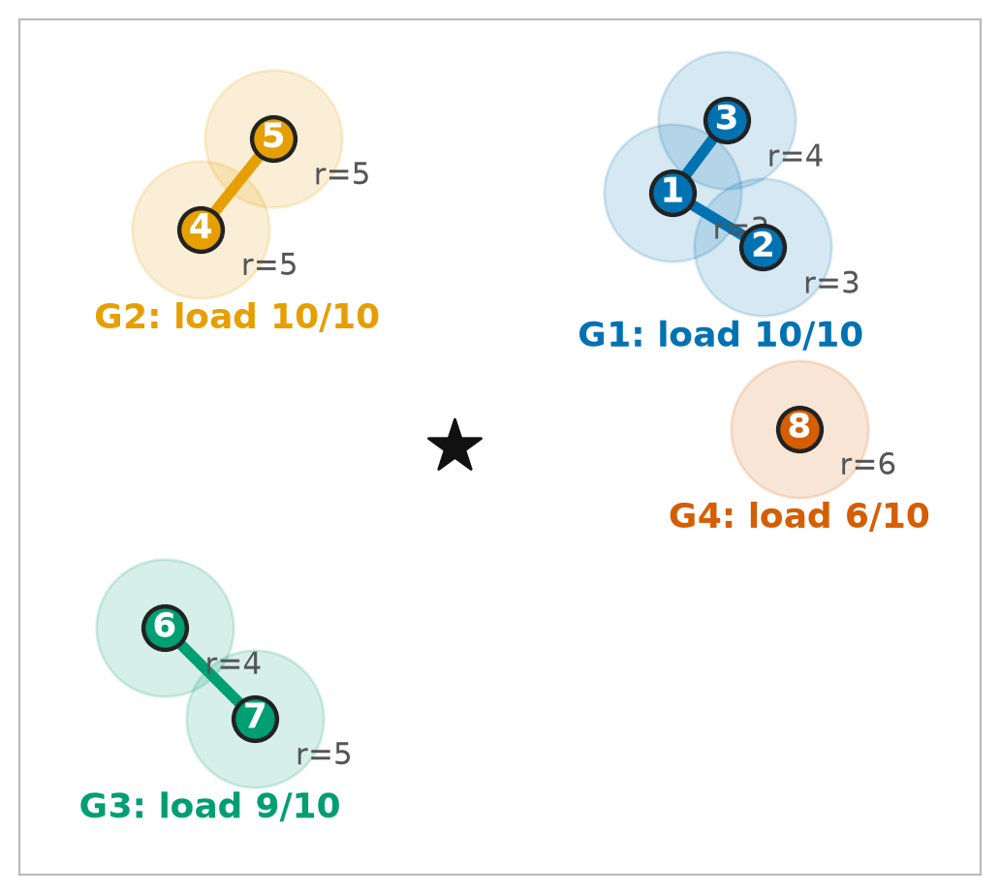
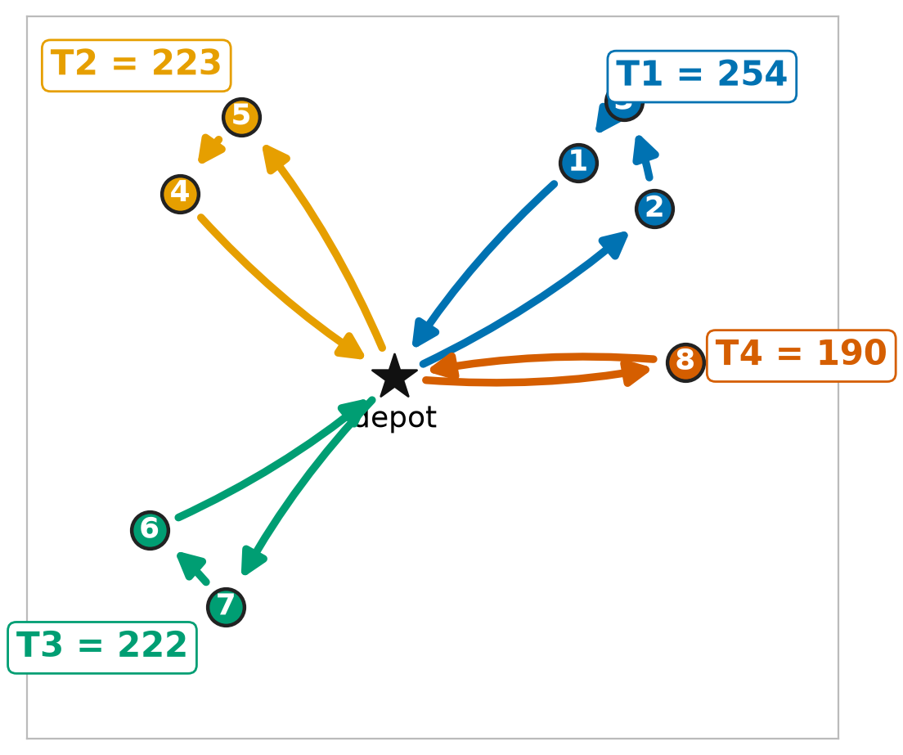
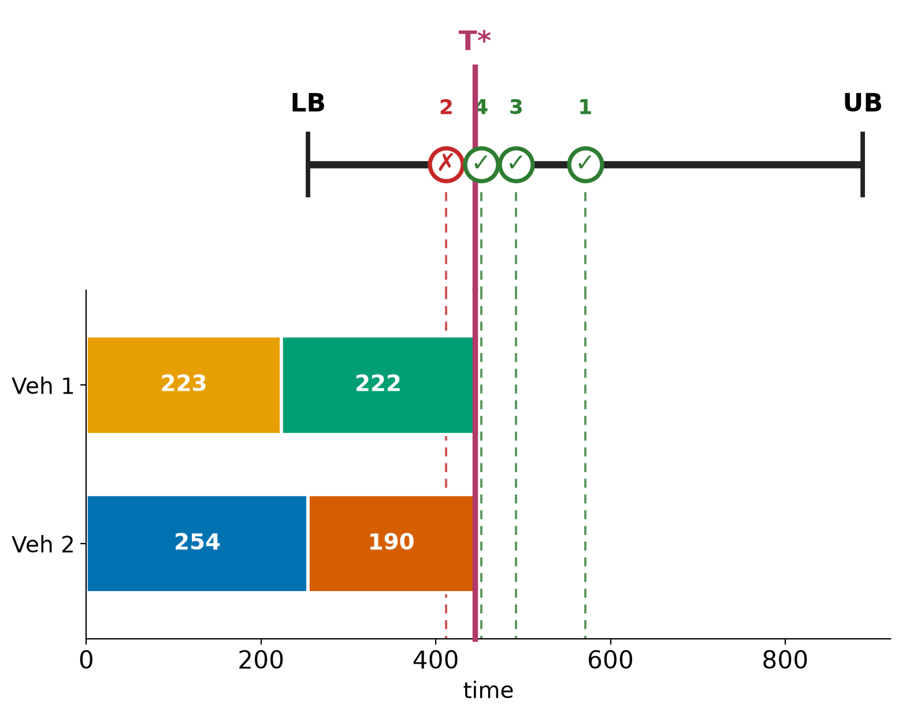
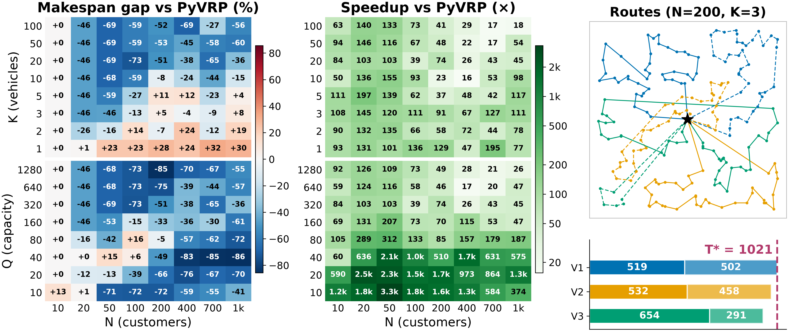

# Group, Solve, Merge!

A fast heuristic for **multi-trip vehicle routing that minimises the makespan**
(the time the last vehicle gets back to the depot).

This repo holds the code and data behind the slides
[`PDF`](inamoto/presentation/FINAL_ZEMI-Polikarpus_Arya_Pradhanika.pdf),
[`PPT`](inamoto/presentation/Group_Solve_Merge_1.pptx),
[`POSTER`](inamoto/presentation/%5BREV_3%5D-POSTER_POLIKARPUS_ARYA.pdf),
(Polikarpus Arya Pradhanika, Ehime University). All the code is in [`inamoto/`](inamoto/).

---

## 1. The problem in one paragraph

There is one depot at (0, 0) and **N** customers. Each customer has a location and a demand
(how many units of goods it needs). There are **K** vehicles, each can carry at most **Q** units per
trip, and a vehicle may go out several times (return to the depot, reload, go again). Travel time is the
straight-line distance. The goal is to serve every customer and make the **makespan T\*** as small as possible.

## 2. The method: 4 steps

| Step         | What it does                                                                                             | Picture (8-customer toy example)           |
| ------------ | -------------------------------------------------------------------------------------------------------- | ------------------------------------------ |
| **1. Prune** | Line sweep from left to right; only nearby pairs become candidate edges, so we never store all N² edges. |  |
| **2. Group** | Kruskal / DSU joins the closest customers while the group still fits in one trip (demand ≤ Q, size ≤ X). |  |
| **3. Solve** | One tour per group: Held-Karp (exact, X = 10) or Lin-Kernighan (X = 40).                                 |  |
| **4. Merge** | Binary search on the makespan; for each guess, two pointers check whether the trips fit on K vehicles.   |  |

In the toy example the 4 trips take 254, 223, 222 and 190, and the merge step packs them onto
2 vehicles with **T\* = 445**.

Where each step lives in the code:

| Step                  | File                                                                   |
| --------------------- | ---------------------------------------------------------------------- |
| Prune + Group         | `inamoto/solutions/linesweep_dsu_tsp.py`                               |
| Solve (Held-Karp)     | `inamoto/solutions/dsu_tsp.py` (`tsp_heldkarp`)                        |
| Solve (Lin-Kernighan) | `inamoto/solutions/lkh_solver.py` (`tsp_lk`)                           |
| Merge (binary search) | `inamoto/solutions/bsta.py`                                            |
| Whole pipeline        | `inamoto/solutions/linesweep_bsta.py` (`solve_linesweep_dsu_tsp_bsta`) |
| Baseline (PyVRP)      | `inamoto/solutions/pyvrp_solver.py`                                    |

### Folder layout

```
inamoto/
├── solutions/        solvers (our pipeline, PyVRP baseline, exact methods for small N)
├── benchmark/        8 x 8 grid scripts used in the slides
├── vrpgen.py         dataset generator library
├── spec.py           list of instances to generate into data/
├── data/             generated .vrp instances
├── results/          benchmark CSVs
├── plots/            figures (poster/ = method pictures, results/ = result figure)
├── logs/             logs of the last benchmark run
├── presentation/     slides (.pptx, .pdf) and poster (.pdf)
├── docs/             notes: problem statement, dataset notes, MILP idea from the professor,
│                     line-sweep demo (open line_sweep.html in a browser), TSP algorithm table
├── solve.py          solve one .vrp file
├── poster_viz.py     draws plots/poster/
├── results_viz.py    draws plots/results/overview_v2.png
├── utils.py          read .vrp, distance matrix, plotting helpers
└── benchmark*.py     older experiments (capacity, x_max, greedy vs BSTA), not in the slides
```

---

## 3. How to run

### Setup (once)

Needs Python 3.13 and [uv](https://docs.astral.sh/uv/).

```bash
cd inamoto
uv sync          # installs numpy, pyvrp, lk-heuristic, pulp, highspy, vrplib (+ matplotlib via pyvrp)
```

All commands below are run **from inside `inamoto/`**.

### Reproduce the slides

| What                                                           | Command                        | Output                                                                                       | Slides |
| -------------------------------------------------------------- | ------------------------------ | -------------------------------------------------------------------------------------------- | ------ |
| Method pictures (toy example)                                  | `uv run python poster_viz.py`  | `plots/poster/1_prune.png` … `4_merge.png`                                                   | 5–8    |
| Both 8 × 8 benchmark grids, then the result figure             | `bash benchmark/run_poster.sh` | `results/n_vs_k.csv`, `results/n_vs_q.csv`, `plots/results/overview_v2.png`, logs in `logs/` | 13–16  |
| Only redraw the result figure from the saved CSVs (no solving) | `uv run python results_viz.py` | `plots/results/overview_v2.png`                                                              | 13–15  |

> **Heads-up:** `run_poster.sh` solves 128 instances and PyVRP alone takes up to ~8 minutes on one
> instance with N = 1000, so the full run takes about 2 hours. Use `results_viz.py` if you only want the figure.

### Other scripts

```bash
uv run python benchmark/n_vs_k.py               # one grid only (also n_vs_q.py, q_vs_k.py, lkh_vs_pyvrp_xmax_vs_q.py)
uv run python benchmark/n_vs_k.py --plot-only   # redraw its heatmaps from results/n_vs_k.csv
bash benchmark/run_all.sh                       # all four grids in a row
uv run python solve.py data/instance-n10-k3.vrp # solve one .vrp file (pick solvers in the list inside solve.py)
```

More detail on the grid scripts and CSV columns: [`inamoto/benchmark/README.md`](inamoto/benchmark/README.md).

---

## 4. Dataset

### Our dataset generator: `vrpgen.py` + `spec.py`

Every instance in this project is made by our own generator. It has two parts:

| File | Role |
|---|---|
| [`inamoto/vrpgen.py`](inamoto/vrpgen.py) | The **library**. `random_customers(n, coord_range, demand_range, seed)` draws the depot at (0, 0) plus N random customers (integer coordinates and demands). `CASE(...)` registers one instance, `generate()` writes every registered instance as a VRPLIB `.vrp` file. |
| [`inamoto/spec.py`](inamoto/spec.py) | The **list of instances**. It calls `CASE(...)` for the hand-made instances (`instance-n6-k2`, the poster toy `poster-n8-k2`) and helpers for the random ones (`create_testcase`, `create_grid`, `create_capacity_sweep`), then `generate()` into `data/`. |

How the two are used:

```
                       vrpgen.random_customers(n, seed=1)
                          /                          \
  spec.py  ->  CASE(...)  ->  generate()        benchmark/common.py  ->  make_data(n, k, q)
                 writes  inamoto/data/*.vrp            builds the instance in memory (no file)
                 (used by solve.py, poster_viz.py)     (used by the benchmark grids in the slides)
```

To regenerate the `.vrp` files:

```bash
cd inamoto
uv run python spec.py     # rewrites data/*.vrp (includes one N = 1,000,000 file of ~22 MB)
```

To add an instance, add a `CASE(...)` or `create_testcase(...)` line in `spec.py` and run it again.

### Benchmark instances (used in the slides)

The benchmark instances are **made in memory** by `make_data(n, k, q, seed=1)` in
`inamoto/benchmark/common.py`, which calls `vrpgen.random_customers`. No file is read.

| Item              | Value                                            |
| ----------------- | ------------------------------------------------ |
| Depot             | (0, 0)                                           |
| Customer location | integer x, y in [-100, 100]                      |
| Customer demand   | integer in [1, 10]                               |
| Random seed       | 1 (same N ⇒ same customers, only K or Q changes) |
| Runs              | one instance per cell, one run per method        |

Two grids, each 8 × 8 = 64 cells. A cell is one pair of values, i.e. one instance:

| Grid      | Varies                                                                                | Fixed   |
| --------- | ------------------------------------------------------------------------------------- | ------- |
| **N – K** | N ∈ {10, 20, 50, 100, 200, 400, 700, 1000}, K ∈ {1, 2, 3, 5, 10, 20, 50, 100}         | Q = 320 |
| **N – Q** | N ∈ {10, 20, 50, 100, 200, 400, 700, 1000}, Q ∈ {10, 20, 40, 80, 160, 320, 640, 1280} | K = 20  |

The 8 cells with K = 20 and Q = 320 appear in both grids (same instance), so there are 120 different instances.

### Methods compared

| Name      | Method                                                          |
| --------- | --------------------------------------------------------------- |
| Held-Karp | our pipeline, exact Held-Karp per group, X = 10                 |
| LK        | our pipeline, Lin-Kernighan per group, X = 40                   |
| PyVRP     | PyVRP 0.14.1, stops after 20,000 iterations without improvement |

"**Ours**" in the results = the better of Held-Karp and LK in each cell.

### Files in `inamoto/data/`

- `poster-n8-k2.vrp`: the 8-customer toy example (Q = 10) used for the method pictures.
- `instance-n*-k*.vrp`: random instances from `spec.py` in VRPLIB format, for trying `solve.py`. Not used in the slides.

### Hardware

Intel Core Ultra 7 155H (22 logical CPUs), 15 GiB RAM, Ubuntu 24.04 (WSL2), Python 3.13.13,
NumPy 2.5.4, PyVRP 0.14.1, lk-heuristic 0.0.4.

---

## 5. Results

Raw numbers: [`inamoto/results/n_vs_k.csv`](inamoto/results/n_vs_k.csv) and
[`inamoto/results/n_vs_q.csv`](inamoto/results/n_vs_q.csv) (one row per cell: makespan and seconds of
each method).



How to read the figure:

- **Left, makespan gap vs PyVRP (%)** = (ours − PyVRP) / PyVRP × 100.
  **Blue (negative) = we win**, red = PyVRP wins. Top: N – K grid. Bottom: N – Q grid.
- **Middle, speedup** = PyVRP seconds / our seconds. Darker = faster.
- **Right**: the routes for N = 200, K = 3. Each colour is one vehicle, each vehicle runs two trips
  (solid and dashed). The bars show the trip durations; the last vehicle is back at **T\* = 1021**.

### Key numbers

| Result                                   | Value                                                                                    |
| ---------------------------------------- | ---------------------------------------------------------------------------------------- |
| Cells where ours beats PyVRP on makespan | **92 of 128 cells** (41 in N – K, 51 in N – Q); counted once per instance: **85 of 120** |
| Speedup in every cell where we win       | **≥ 15×** (smallest: 15.6×)                                                              |
| Median speedup in those cells            | **103×**                                                                                 |

What it means:

- With **many vehicles** (K ≥ 10) we are better almost everywhere, often by 40–70%, and 16–155× faster.
- With **1–5 vehicles** PyVRP is often better. PyVRP minimises the _total distance_; with few vehicles
  that is close to the makespan, so it plays to its strength. With K = 1 the two goals are identical.
- With **N = 10** both find the same answer (gap +0).

### Limitations (slide 17)

- Two small groups that together fit in one trip stay as two separate trips; we cannot merge them.
- Exact methods only scale to N ≤ 20, so for large N the gap to the true optimum is unknown.
